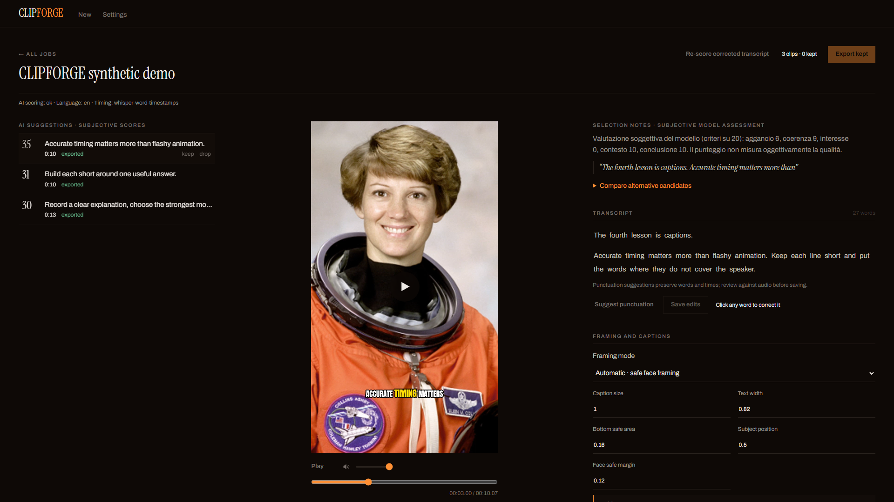
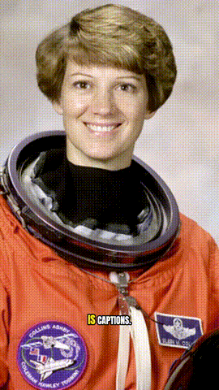

<h1 align="center">CLIPFORGE</h1>
<p align="center"><strong>Turn long videos into captioned clips. Keep the AI on your computer.</strong></p>
<p align="center">Free source code · Local inference · Windows first · Alpha</p>

CLIPFORGE is an independent, MIT-licensed adaptation of AutoClip. Import a local
video, transcribe it with faster-whisper, compare Ollama highlight suggestions,
correct the words, adjust framing and export real H.264/AAC MP4 files without a
watermark. No account or paid API is required.

**This is an early working editor, not a promise of professional transcription
or viral clips.** Review names, punctuation, boundaries and subjective AI scores.
The community marketplace is planned; it does not exist in this release.



[Italian getting started / Guida italiana](docs/GETTING-STARTED-IT.md) ·
[Installation troubleshooting](docs/INSTALLATION.md) ·
[Deployment](docs/DEPLOYMENT.md) · [Validation and audit](docs/RELEASE-AUDIT.md)

## For a technical portfolio review

This is an independent adaptation of AutoClip; upstream attribution and license
information are retained in [NOTICE](NOTICE) and [LICENSE](LICENSE).

- [Typed frontend API client](frontend/src/api.ts): request/response contracts
  between the editor and Python backend.
- [FastAPI routes](backend/autoclip/api/): jobs, sources, clips and settings.
- [Ollama HTTP provider](backend/autoclip/providers/ollama_provider.py): local
  model calls, structured-output contracts, timeout and error handling.
- [API tests](tests/test_api.py) and
  [release-security scenarios](tests/test_release_security.py).

The screenshots and demo below are labelled synthetic fixtures. This is a
Windows-first alpha, not a customer deployment or a production service.

## What works

- Local MP4/MOV/WebM and other supported media; optional rights-permitted YouTube ingest.
- Word-level faster-whisper transcription, explicit language selection, CUDA with CPU fallback.
- Local Ollama rubric scoring, transcript-grounded title fallback and candidate comparisons.
- Sentence-boundary checks and overlap suppression; fewer clips when material is unsuitable.
- Persistent word corrections, readable transcript grouping and reviewable punctuation suggestions.
- Automatic safe framing, whole-scene fit and manual static portrait positioning.
- Four caption presets with configurable size, width and bottom safe area.
- Seekable preview, numeric trim and saved settings; exact preview plays the rendered MP4.
- 1080×1920 H.264/AAC exports; also square/landscape output. No app watermark.
- Resumable stages and cooperative cancellation; an active model call may finish before cancellation.

## Compared with a paid clipping service

This is a feature comparison, **not an accuracy or speed benchmark**.

| Capability | CLIPFORGE alpha | OpusClip paid plans |
| --- | --- | --- |
| Software cost | Free MIT source; your hardware/electricity/storage | Subscription/credits according to vendor plan |
| Captions and AI clip suggestions | Implemented locally; review required | Advertised AI clipping and captions |
| Watermark-free download | Yes | Advertised in Starter and higher |
| Direct social posting | Not implemented | Advertised in Starter and higher |
| Team workspace / managed support | Not implemented; no SLA | Plan dependent |

Vendor features were checked against [OpusClip's pricing page](https://www.opus.pro/pricing)
on 2026-10-26 and may change. No claim of matching its quality or feature breadth.

## Windows Quick Start

This is **not one-click installation**. Install these free prerequisites first:

1. [Python 3.12](https://www.python.org/downloads/) with the Windows launcher (3.11 also supported).
2. [Node.js](https://nodejs.org/) active LTS, version 20 or newer; Node 24 is tested here.
3. [FFmpeg full build](https://www.gyan.dev/ffmpeg/builds/) on PATH, including `ffprobe`, `libass` and `libx264`.
4. [Ollama](https://ollama.com/download/windows). No account is needed for local models.

Download this repository with **Code → Download ZIP**, extract it, and open
PowerShell in that folder. Or, if Git is installed:

```powershell
git clone https://github.com/Apelle333/clipforge.git
cd clipforge
```

Check prerequisites, install, then launch:

```powershell
.\Install-CLIPFORGE.ps1 -CheckOnly
.\Install-CLIPFORGE.ps1
.\Launch-CLIPFORGE.ps1
```

The installer creates `.venv`, installs pinned dependencies, builds the interface
and downloads free Whisper-small, MediaPipe and phi4-mini weights. Allow several
GB of disk space and time for downloads; NVIDIA runtime wheels add more. It
does not install system prerequisites or change PowerShell execution policy.
If scripts are blocked, follow your administrator's policy or the
[manual installation commands](docs/INSTALLATION.md); do not use ExecutionPolicy Bypass.

The launcher opens your browser after the local backend is ready:
**http://127.0.0.1:8078**. Stop with Ctrl+C. Use `-NoBrowser` to skip opening it.
The dedicated Ollama server uses **127.0.0.1:11436**, cloud disabled, one model at a time.

### CPU-only

```powershell
.\Install-CLIPFORGE.ps1 -Cpu
.\Launch-CLIPFORGE.ps1 -Cpu
```

This forces CPU transcription/Ollama inference and software encoding. It can be
substantially slower, particularly for large ASR models or long videos. There is
no CPU performance guarantee. CUDA is optional; supported NVIDIA hardware needs
a working driver. No separate CUDA Toolkit is required for the pinned runtime wheels.

### Data and updates

New installs store private media, transcripts, jobs and weights under
`%LOCALAPPDATA%\CLIPFORGE`, outside the repository. `AUTOCLIP_HOME` can override
this. Existing sibling `data` installations are retained; no jobs are migrated
or overwritten. `.env.example` is for Compose, not a Windows settings loader.

Stop the app, back up the data directory, then run `Update-CLIPFORGE.ps1` for a
clean official Git checkout. It refuses local changes and uses fast-forward
only. ZIP users should extract a new version into a separate folder and reuse
their data directory. Never delete your data folder to fix an installation.

## Make a clip

1. Open **New** and drag in media you own or have permission to process.
2. In **Settings**, confirm `phi4-mini:latest`, the local Ollama URL, ASR model
   and source language. Force **Italian** for Italian-only speech if needed.
3. Generate clips and wait for transcription, scoring, framing and rendering.
   Missing model/scoring errors are shown; no fabricated fallback score is promised.
4. Open a job. Compare suggestions and rubric notes; scores are subjective,
   not an objective quality/virality measure. Keep/discard clips and adjust trim.
5. Click transcript words to correct them, then **Save edits**. Corrections
   retain measured timings. Punctuation suggestions preserve vocabulary and
   need review against audio. Re-score into a new job after lexical corrections.
6. Choose caption style, size, width and safe area. Choose **Fit** to preserve
   the scene, or **Manual** to position a static crop; inspect the entire face.
7. Use **Render exact preview** to see actual burned subtitles and framing.
   The live draft is a CSS approximation. Export MP4 and download the result.

Whisper-small is a lightweight starting point, not the accuracy ceiling.
Large-v3 and turbo are available in Settings and need additional download/VRAM.
Models run sequentially to reduce contention on 8 GB GPUs. Names, rapid speech,
overlap and silence can still produce ASR mistakes. Optional WhisperX alignment
is isolated and strictly falls back on failure; see `Setup-Alignment.ps1`.

## Real exported demo



This is a **silent excerpt of an actual pipeline export from a synthetic test
fixture**, not a customer result or a recording of the pictured person speaking.
The NASA image is public domain; no endorsement is implied. See
[demo provenance](docs/assets/README.md). Private Italian test footage and its
transcripts/exports are intentionally not redistributed.

## Docker

CPU and optional NVIDIA Compose configurations are supplied. Both bind the
host app port to loopback; Ollama has no published port. See
[deployment status and commands](docs/DEPLOYMENT.md). Compose validation does
not mean a successful container build/inference test. Check the audit for tested status.
This Python/FFmpeg/model service cannot be deployed as a static Vercel website.
Never expose this unauthenticated alpha directly to the public internet.

## Troubleshooting and limits

- **Missing command / no captions:** reopen your terminal after installing prerequisites;
  verify FFmpeg full (`ass` filter, `libx264`). Run the read-only install check.
- **Ollama unavailable / timeout:** use the dedicated launcher; confirm weights
  with `ollama list` against port 11436. Retry failed jobs after resolving the cause.
- **CUDA DLL/OOM:** update the NVIDIA driver, close other GPU-heavy work, try
  a smaller model or `-Cpu`. Do not load several large models simultaneously.
- **Draft differs from export:** use rendered preview. Draft fit lacks the
  exported blurred background and CSS text is not libass.
- **Wrong words / weak titles / incomplete context:** correct the transcript
  and trim manually. Lexical title grounding does not prove semantic correctness.
- **No clips:** missing punctuation or unsuitable duration/content may leave
  no complete candidates; do not mistake this for successful AI clipping.
- **YouTube blocked:** start with local input. Do not bypass DRM or access controls.

No professional ASR accuracy certification, continuous active-speaker guarantee,
internet multi-user service, automatic publishing or community marketplace is
claimed. See [known verification limits](docs/RELEASE-AUDIT.md).

## Roadmap and contributing

Next: listening-verified Italian quality corpus, stronger local ranking,
continuous framing/browser regressions and simpler signed Windows packaging.
A versioned preset format and optional community sharing come later.

[Contributing](CONTRIBUTING.md) · [Code of conduct](CODE_OF_CONDUCT.md) ·
[Security policy](SECURITY.md) · [Changelog](CHANGELOG.md)

## License and attribution

MIT source: original CLIPFORGE modifications and inherited AutoClip code,
with Jad Ghazi's copyright retained. Bundled fonts use SIL OFL; model weights,
NVIDIA runtimes and external FFmpeg have separate terms. Read [LICENSE](LICENSE),
[NOTICE](NOTICE) and [third-party notices](docs/THIRD-PARTY-NOTICES.md).
Foundation: [AutoClip](https://github.com/artbyjazi/autoclip), commit
`5d0eac36fa615b79dd2104083bf273a96f8d68bb`. No affiliation is implied.
